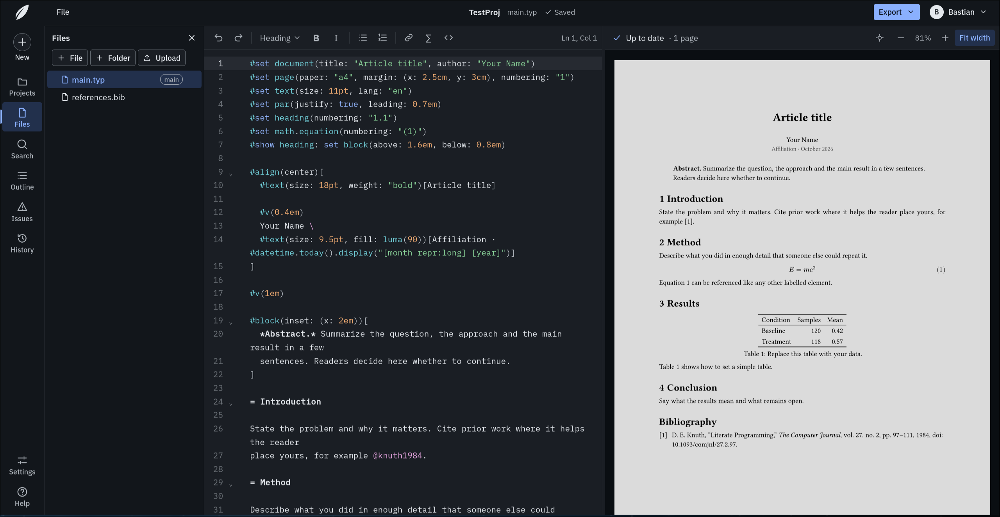

<div align="center">


# Kernic

**A self-hosted, Git-first workspace for [Typst](https://typst.app).**

Write multi-file Typst documents in the browser, see the pages render next to the source, and keep every version in Git.

[](https://github.com/pruefsumme/kernic/actions/workflows/ci.yml)
[](https://github.com/pruefsumme/kernic/releases)
[](LICENSE)

[Self-hosting](docs/self-hosting.md) · [Backups](docs/backups.md) · [Changelog](CHANGELOG.md)

</div>

<br>



## Features

- **Editor:** multi-file projects, syntax highlighting, completion, hover docs, go to definition and formatting through Tinymist
- **Live preview:** compiler errors linked to the source, and click-to-jump between pages and source
- **Export:** PDF (including PDF/A and PDF/UA) or a ZIP of the project
- **History:** checkpoints as Git commits, with diffs and restore. Push to and pull from Forgejo or Gitea
- **Sharing:** workspaces with viewer, editor and owner roles, plus read-only links for people without an account
- **Packages:** Typst Universe packages, cached on the server
- **Isolation:** documents compile in a sandboxed worker with no network and no database access

## Quick start

Requires Docker with the Compose plugin and Linux 5.13 or later.

```sh
git clone https://github.com/pruefsumme/kernic.git
cd kernic/deploy
cp .env.example .env      # set KERNIC_SITE_ADDRESS, POSTGRES_PASSWORD, KERNIC_WORKER_TOKEN
./preflight.sh
docker compose up -d --build
```

Open the site and create the admin account with the setup token from `docker compose logs app`.
For domains, published images, backups and upgrades, see the **[self-hosting guide](docs/self-hosting.md)**.

## Development

Requires Node 24+, pnpm, Docker, Git, and the [Typst CLI](https://github.com/typst/typst), [Tinymist](https://github.com/Myriad-Dreamin/tinymist) and `bubblewrap` on your `PATH`.
`scripts/install-typst-tools.sh` installs the pinned Typst and Tinymist versions.

```sh
pnpm install
cp .env.example .env
docker compose -f compose.dev.yaml up -d --wait
pnpm dev                   # app on :5173, worker on :3101
```

| Command | What it does |
| --- | --- |
| `pnpm check` | Type-check |
| `pnpm lint` | Prettier and ESLint |
| `pnpm test` | Unit tests |
| `pnpm test:e2e` | Browser tests against a production build |
| `pnpm test:durability` | Crash-during-save stress test |

## Architecture

| Part | Path | Role |
| --- | --- | --- |
| Web app | `apps/web` | SvelteKit: UI, API, sessions, compile queue |
| Worker | `apps/worker` | Runs Typst and Tinymist in a sandbox |
| Database | PostgreSQL | Users, workspaces, metadata, jobs |
| Storage | `KERNIC_DATA_DIR` | Project files and rendered pages |

## Roadmap

- Real-time collaboration
- Review comments
- A preview that updates on every keystroke

## License

[AGPL-3.0-only](LICENSE) © 2026 pruefsumme. Typst and Tinymist are Apache-2.0.
